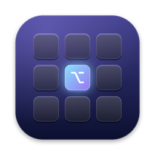

<p align="center">
  
</p>

<h1 align="center">Keyspace</h1>

<p align="center">
  <b>Lightning-fast spaces on keys for macOS.</b><br>
  <code>⌥1</code> for Browser, <code>⌥2</code> for Code, <code>⌥S</code> for Slack.<br>
  Press a key — that space's apps appear and everything else vanishes instantly.
</p>

<p align="center">
  <a href="https://github.com/lakshya-rohila/keyspace/releases"></a>
  
  
  
  
  <a href="LICENSE"></a>
</p>

<p align="center">
  <a href="docs/keyspace-reel.mp4"><b>▶ Watch the 28-second demo video</b></a>
</p>

---

## ⚡ The Philosophy

Tiling window managers (like AeroSpace, Yabai, or Amethyst) offer great keyboard navigation, but they often make macOS stutter, break multi-monitor displays, and require invasive system permissions. Native macOS Spaces are notoriously slow, with sluggish slide animations and a tendency to shuffle spaces automatically.

**Keyspace takes the best part — dedicated workspaces bound to physical keys — and throws away the friction:**

* 🚀 **Instant, zero-animation switching** — Uses macOS's native hide/unhide mechanism (equivalent to `⌘H`). No stuttering, no display lag.
* 🛡️ **Zero system permissions** — No Accessibility API, no Input Monitoring permission, and no Screen Recording required.
* 🧠 **Unbreakable memory** — Remembers app assignments by bundle ID in `~/.config/keyspace/spaces.json`. Reboots, crashes, app updates — everything returns to its assigned key.
* 💤 **0.0% CPU when idle** — Purely event-driven via Carbon hotkeys and `NSWorkspace` notifications. Absolutely no polling loops.
* 🔤 **Numbers and Letters** — Keys `1`–`9` out of the box, plus any of `A`–`Z` (`⌥B` for Browser, `⌥T` for Terminal, `⌥S` for Slack).

---

## 🎯 Use Cases

Keyspace adapts to the way you think and work:

### 1. 💻 The Software Engineer
Keep deep-work code isolated from distractions:
- **`⌥1` (Browser & Docs):** Arc / Chrome + Dash / DevDocs
- **`⌥2` (Editor & CLI):** VS Code / Cursor + Ghostty / iTerm2
- **`⌥3` (Data & Ops):** Docker Desktop + TablePlus / Postman
- **`⌥S` (Comms):** Slack + Discord — tucked away until standup.

### 2. ✍️ The Content Creator & Writer
Eliminate screen clutter while drafting or researching:
- **`⌥1` (Writing):** Obsidian, Notion, or Ulysses in focused full view
- **`⌥2` (Research):** Safari with reference tabs and PDFs
- **`⌥M` (Media):** Spotify / Apple Music for background soundtrack.

### 3. 🎓 The Student & Researcher
Group project resources into dedicated keys:
- **`⌥1` (Study):** Anki + Zotero + PDF Reader
- **`⌥2` (Drafting):** Word, LaTeX editor, or Google Docs
- **`⌥C` (Reference):** Calculator, ChatGPT / Claude desktop app.

### 4. 🔕 The Anti-Distraction Deep Worker
Stop notifications and open communication apps from hijacking your focus:
- Put Slack, Mail, WhatsApp, and Telegram on **`⌥9`** or **`⌥S`**.
- During focus blocks, switch to your work key. Communication apps stay completely hidden — out of sight, out of mind — until you deliberately check in.

---

## 🕹️ Comparison

| Feature | Keyspace | Native macOS Spaces | Tiling Managers (AeroSpace/Yabai) |
|---|:---:|:---:|:---:|
| **Switch Latency** | **Instant (0ms)** | Slow (~500ms slide) | Instant / Variable |
| **Permissions Needed** | **None** | None | Accessibility + Screen Recording |
| **Idle CPU Usage** | **0.0%** | Minimal | Constant background hooks |
| **Persists Across Reboots** | **Always** | Unreliable | Partial |
| **Letter Keybindings (`⌥B`, `⌥T`)** | **Yes (`A`–`Z`)** | No (1–9 only) | Config-based |
| **Multi-Display Friendly** | **Native** | Often shifts displays | Can break layouts |

---

## 📥 Installation

### Option 1: One-Line Installer (Recommended)

Paste this into your Terminal:

```bash
curl -fsSL https://raw.githubusercontent.com/lakshya-rohila/keyspace/main/get.sh | bash
```

> **What this does:** Downloads the latest release, installs `Keyspace.app` into `/Applications`, and starts it immediately. Run this command again anytime to update. Your spaces and assignments are never overwritten.

### Option 2: Manual Download

1. Download **`Keyspace-macOS.zip`** from [Releases](https://github.com/lakshya-rohila/keyspace/releases/latest).
2. Unzip and move **`Keyspace.app`** to `/Applications`.
3. Open it. *(If macOS displays an unnotarized app prompt, right-click `Keyspace.app` → **Open** → **Open**, or run `xattr -dr com.apple.quarantine /Applications/Keyspace.app`)*.

### Option 3: Build From Source

Requires macOS 13+ and Xcode Command Line Tools:

```bash
git clone https://github.com/lakshya-rohila/keyspace.git
cd keyspace
./install.sh
```

---

## ⌨️ Shortcuts & Usage

| Action | Shortcut | Description |
|---|---|---|
| **Switch to Space** | `⌥` + `Key` | Switches instantly to that space (e.g. `⌥1`, `⌥2`, `⌥B`). |
| **Send App to Space** | `⌥⇧` + `Key` | Moves frontmost app to that space (e.g. `⌥⇧2` sends it to Space 2). |
| **Pause / Resume** | `⌥⇧0` | Pauses Keyspace and reveals all hidden windows at once. |
| **Open Settings** | `⌘,` | Opens visual drag-and-drop settings and preferences. |

### Smart Behaviors:
* 🔀 **Dock & ⌘-Tab Follow:** Clicking an app in the Dock or switching via `⌘-Tab` automatically shifts Keyspace to that app's assigned space.
* ➕ **Auto-Assign (Optional):** Newly launched apps automatically join your currently active space (toggleable in Settings).
* 🚀 **Launch Missing Apps (Optional):** Switching to a space can automatically launch assigned apps if they aren't already running.
* 🛡️ **Safe Exit:** Quitting Keyspace from the menu bar immediately un-hides all apps — no window is ever left stranded.
* ⚙️ **Configurable Modifier:** If `⌥` clashes with special characters or existing workflows, swap it to `⌃⌥` or `⌃` in Settings.

---

## 🖥️ Visual Settings

Keyspace includes a native SwiftUI settings panel:

* **Spaces Tab:** Visual drag-and-drop management. Add number keys (`1`–`9`) or letter keys (`A`–`Z`). Drag apps between spaces or drop them in the "Floating" box to make them always visible.
* **General Tab:** Configure startup behavior (*Launch at login* via `SMAppService`), customize hotkey modifiers, and inspect your configuration file.
* **Guide Tab:** Interactive onboarding walkthrough.

---

## 🛠️ Architecture & Under the Hood

```
Sources/Keyspace/
├── main.swift           # Application entry point
├── AppDelegate.swift    # Status bar item, lifecycle, and workspace observation
├── HotKeys.swift        # Low-level Carbon RegisterEventHotKey registration
├── Switcher.swift       # Fast activation & native app hide/unhide logic
├── SpaceStore.swift     # Codable persistent state (~/.config/keyspace/spaces.json)
└── SettingsView.swift   # SwiftUI settings UI with fluid Drag & Drop
```

* **Carbon `RegisterEventHotKey`:** Rather than tapping into every keystroke via `CGEventTap` (which triggers security warnings and requires Input Monitoring permissions), Keyspace registers specific key combinations directly with macOS.
* **Atomic JSON Storage:** All state is written atomically to `~/.config/keyspace/spaces.json`. You can easily version-control your configuration or sync it across machines.

---

## 🤝 Contributing

Contributions, issues, and feature requests are welcome!

1. Fork the repository
2. Create your feature branch (`git checkout -b feature/amazing-feature`)
3. Commit your changes (`git commit -m "Add amazing feature"`)
4. Push to the branch (`git push origin feature/amazing-feature`)
5. Open a Pull Request

---

## 📄 License

Distributed under the MIT License. See [LICENSE](LICENSE) for details.

<p align="center">
  Made with ❤️ for macOS power users.
</p>
